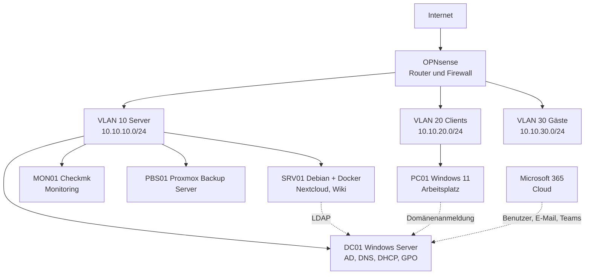

# Homelab: IT-Infrastruktur eines kleinen Unternehmens

**Status:** im Aufbau · Projektstart (Konzept): Oktober 2026

In diesem Projekt baue ich die komplette IT-Infrastruktur eines fiktiven Unternehmens, der **Muster GmbH** mit 20 Mitarbeitenden, in einer virtualisierten Umgebung auf. Ziel ist es, den Alltag eines Netzwerk- und Systemadministrators praktisch abzubilden: Netzwerk, Benutzerverwaltung, Linux-Dienste, Monitoring, Backup, Automatisierung und Microsoft 365.

Jede Komponente erfüllt einen konkreten Zweck für das Unternehmen. Alle Schritte, Konfigurationen und Skripte werden in diesem Repository dokumentiert.

## Szenario

Die Muster GmbH hat drei Abteilungen (Verwaltung, Vertrieb, IT). Jeder Mitarbeitende soll:

- **ein einziges Benutzerkonto** für Windows-Anmeldung, Dateiserver und Wiki haben,
- automatisch eine IP-Adresse erhalten und Dienste über Namen erreichen,
- seine Dateien zentral speichern und teilen können.

Gäste erhalten nur Internetzugang. Die IT wird über Monitoring informiert, wenn ein System ausfällt, und alle Server werden regelmäßig gesichert.

## Architektur



Alle virtuellen Maschinen laufen auf einem Host mit **Proxmox VE**. Details zur Adressierung: [docs/netzplan.md](docs/netzplan.md).

## Technologien

| Bereich | Technologie |
| --- | --- |
| Virtualisierung | Proxmox VE |
| Netzwerk | VLANs, Inter-VLAN-Routing, OPNsense |
| Verzeichnisdienst | Windows Server 2022: Active Directory, DNS, DHCP, Gruppenrichtlinien (GPO) |
| Linux-Server | Debian 12, SSH |
| Container | Docker, Docker Compose, Nextcloud, BookStack |
| Integration | LDAP (Anmeldung an Nextcloud mit AD-Konto) |
| Monitoring | Checkmk Raw Edition |
| Backup | Proxmox Backup Server inkl. Restore-Tests |
| Automatisierung | PowerShell, Ansible |
| Cloud | Microsoft 365 (Administration) |
| Dokumentation | Markdown, Mermaid, Git |

## Roadmap

- [x] **Phase 0:** Konzept, Szenario, Netzplan und Repository
- [ ] **Phase 1:** Proxmox VE installieren, erste Debian-VM per SSH verwalten
- [ ] **Phase 2:** VLANs und OPNsense, Routing und Firewall-Regeln zwischen den Netzen
- [ ] **Phase 3:** Windows Server mit Active Directory, DNS, DHCP und GPO, Windows-11-Client in der Domäne
- [ ] **Phase 4:** Debian-Server mit Docker, Nextcloud und Wiki, Anmeldung über LDAP
- [ ] **Phase 5:** Monitoring mit Checkmk, Backups mit Proxmox Backup Server und Restore-Test
- [ ] **Phase 6:** Automatisierung mit PowerShell (AD-Benutzer) und Ansible (Debian-Konfiguration)
- [ ] **Phase 7:** Administration von Microsoft 365 (Benutzer, Lizenzen, Postfächer, Teams, MFA)

Der Fortschritt wird im [Projekttagebuch](docs/projekttagebuch.md) festgehalten.

## Struktur des Repositorys

```
homelab-muster-gmbh/
├── README.md                 Projektübersicht
├── docs/
│   ├── netzplan.md           VLANs, IP-Adressen, Hostnamen
│   └── projekttagebuch.md    Fortschritt und Erkenntnisse
├── scripts/powershell/       Skripte für Active Directory
├── ansible/                  Playbooks für die Debian-Server
└── docker/                   Docker-Compose-Dateien
```

## Lernziele

- Aufbau und Betrieb einer segmentierten Netzwerkinfrastruktur
- Zentrale Benutzer- und Rechteverwaltung mit Active Directory und GPO
- Bereitstellung von Linux-Diensten mit Docker und deren Anbindung an Active Directory
- Überwachung, Datensicherung und Wiederherstellung im Betrieb
- Automatisierung wiederkehrender Aufgaben
- Verwaltung einer Microsoft-365-Umgebung

## Autor

**Maxime Stéphane Atonzon Tamankeu**
Informatik-Masterstudent an der Universität Hamburg, Schwerpunkt Netzwerke, verteilte Systeme und IT-Sicherheit
